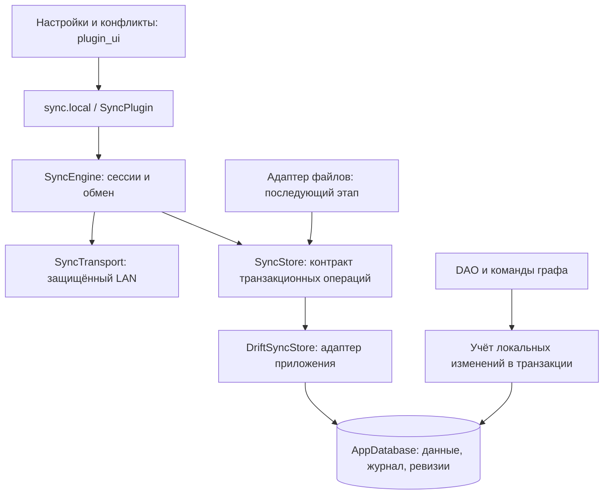

# Синхронизация Life OS между устройствами

Статус на 16.11.2026: реализованы ядро, этапы 2а–2в и первый сетевой этап 3а,
была введена схема SQLite v12. Есть ручной TLS/LAN-обмен, сопряжение и настройки/конфликты.
С 19.11.2026 схема v13 добавляет восстанавливаемый локальный индекс текущих
ревизий для чтений и адресной записи статусов. Формат обмена не меняется.
Детали и замеры: [status-performance.md](status-performance.md).
С 22.11.2026 SQLite v15 хранит локальные контрольные точки Markdown, а
ревизии v5 поддерживают привычки, отметки по календарному дню и файлы из
активной папки Notes. Сеанс LAN планирует конечные диапазоны журнала
в обе стороны, сохраняя причинный порядок; UI считает подтверждённые записи
по типам и завершает сеанс после применения Markdown на обоих устройствах.
Ревизии v6 поддерживают обычные текстовые стикеры основной доски. Контрольные
точки используют ту же таблицу SQLite v15 и область по файлу Canvas. Доски
принимают изменения по ID сферы и стикера с файловой проверкой исходного снимка.
Ревизии v7 добавляют ссылки карточек Markdown на путь относительно Notes.
Ревизии v8 описывают геометрию бизнес-узлов. В v9 передаётся вся основная
доска сферы. Снимки учитывают ссылки на локальную папку Notes, а замены
сохраняют предыдущий Canvas в Backups. Формат Markdown остаётся прежним.
Практическое руководство — [local-sync.md](local-sync.md). Разделы ниже описывают целевую
архитектуру; фактический состав первого среза указан отдельно.

### Первый срез (история)

- Чистый пакет sync_plugin: причинные ревизии, конфликты, строгий кодек задачи,
  SyncStore и SyncEngine для обмена между двумя объектами хранилища.
- DriftSyncStore: save/complete/delete, проверка ожидаемых версий, разрешение
  конфликтов, атомарный импорт и курсор, повторы, pending, ретрансляция.
- Миграция v11 добавляет sync_identities, sync_revisions и sync_cursors.
  Журнал одновременно служит feed; heads/parents/pending вычисляются из него.
  Отдельные индексированные проекции добавляются при масштабировании.
- Bootstrap выполняется явной initialize в транзакции, а не автоматически
  в миграции: до охвата всех путей записи приложения база не считается
  синхронизируемой. Это уточнение последовательности этапов 1–2.
- Поддерживаются только самостоятельные задачи без тегов и WorkLogs.
  Связанные записи отклоняются без изменения данных. Изменения вне журнала
  блокируют экспорт и перезапись, вместо молчаливой потери локальной версии.

Сетевой AppPlugin не регистрируется. Нет ключей/доверенных peer, групповых
операций и переноса заполненных пространств. Не запускать этот программный
стенд на пользовательской базе. До LAN-релиза нужен полный этап 2.

### Подключение записей: этап 2а

Контейнер передаёт DriftSyncStore в TasksDao, WorkLogsDao и DriftGraphDeletion
через TaskMutationJournal. Без sync_identity журнал пропускает обычные операции.
Явный experimentalSyncDatasetId запускает bootstrap до старта плагинов.
Если база уже подключена, журнал работает после перезапуска и без этого параметра:
отключение сетевого модуля не отключает учёт. Сам store не владеет ресурсами,
его транзакции используют существующую AppDatabase.

TasksDao ведёт журнал create/update/complete/delete самостоятельных задач в одной
транзакции с данными. Завершение через MCP остаётся узким обновлением статуса
и updatedAt; повторный complete не порождает ревизию. Add не заменяет существующий
или удалённый ID при активном журнале.

Task.storageRevision — необязательный непрозрачный токен прочитанного снимка.
DAO добавляет его к getById, getAll и потокам; copyWith сохраняет токен.
Репозиторий передаёт токен при полном обновлении карточки. Отсутствующий или
устаревший токен отклоняется, даже если updatedAt совпадает. Запоздалому снимку
потока нельзя присвоить новую версию: при несовпадении payload токен отсутствует.
Токен не входит в бизнес-таблицы, JSON обмена или сравнение переносимых данных.

Узкие complete/delete по ID читают текущее состояние в транзакции. При конфликте
или pending обычные команды отклоняются до явного разрешения. Ошибка журнала
откатывает бизнес-запись; ошибка проверки после записи также откатывает транзакцию.

Ограничения этапа 2а: кодек всё ещё поддерживает только самостоятельные задачи.
Добавление ссылок/тегов и WorkLogs в подключённой базе отклоняется с откатом.
Графовые удаления, включая keepChildren, блокируются целиком до протокола групп.
Это защита экспериментального режима, а не реализация синхронизации иерархии.
По умолчанию база не подключается к эксперименту; обычные графовые операции,
связи и журналы времени сохраняют прежнее поведение.

Далее в этапе 2: переносимые идентификаторы тегов, WorkLogs и зависимости задач,
групповые ревизии для графовых команд, проверка циклов и безопасный bootstrap
полной базы. UI конфликтов и сетевой транспорт относятся к этапу 3.

### Иерархия задач, WorkLogs и группы: этап 2б

Ревизии v2 содержат entityType (task/workLog) и необязательный groupId с полным
списком groupMembers. Старые v1 читаются без переписывания тела или ID.
Оболочка v2 нужна иерархии задач, WorkLogs и многосущностным транзакциям.
Старый клиент, понимающий только v1, должен отклонять v2 до подтверждения приёма.
Схема SQLite остаётся v11: новые сведения хранятся в существующем body.

WorkLog — отдельная сущность с прежним UUID и интервалами, а не поле-снимок
задачи. WorkLogsDao и репозиторий участвуют в журнале; storageRevision также
проверяется при полном обновлении WorkLog и сохраняется copyWith. Параллельное
создание разных WorkLogs объединяется, конкурентная правка одного ID сохраняет
оба варианта. saveWorkLog/deleteWorkLog позволяют явно разрешить конфликт
с проверкой ожидаемых вершин. Завершение задачи не перезаписывает её WorkLogs.

trackGraph захватывает изменения задач и WorkLogs до/после команды. Изменения
связываются общей группой; вложенные вызовы DAO внутри неё не создают дубликаты.
Транзакционный контекст изолирован через Zone, а не общий изменяемый флаг.
Удаление поддерева задач и keepChildren сохраняют прежние команды, включая
каскадное удаление WorkLogs и отвязку детей, но журналируют всю группу.

Получатель хранит неполные группы в журнале, подтверждает их устойчивое
получение и не материализует ни одного участника до полноты группы и её
причинных родителей. Разбиение по лимиту 100 записей/4 MiB не меняет атомарность.
Перезапуск восстанавливает pending из журнала. Разные manifests одного groupId,
чужой автор группы и повторное изменение одной сущности в группе отклоняются.
В группе не более 1000 ревизий; превышение пока отклоняет всю локальную команду.

Ссылки на родительские задачи и принадлежность WorkLog проверяются до
материализации. Отсутствующий объект или цикл делают соответствующие версии
pending; существующие предки остаются доступными, если их связи допустимы.
Если родитель удалён, зависимые неподтверждённые варианты скрываются из
бизнес-таблиц, но остаются в журнале/readPending. Это не удаление их истории.
При новой корректной зависимости проекция может восстановиться.

Локальная команда, создающая цикл/висячую связь, полностью откатывается.
Для цикла из конкурентных офлайн-правок repairPendingTask принимает исправленную
карточку и точный набор текущих вершин плюс pending-версий этой задачи.
Исправление создаёт новую ревизию, а не стирает ошибочные. При изменении основы
или недостающих причинных родителях операция отклоняется. Это программное API;
пользовательского экрана исправления пока нет.

Ограничения: проекты, цели, сферы и теги ещё не синхронизируются. Задачи с такими
ссылками/тегами по-прежнему отклоняются; графовая команда, меняющая эти таблицы,
откатывается целиком. Привычки, Markdown и Canvas не входят в этот срез.
Snapshot/projection вычисляются по всему тестовому набору: индексы и проекции
нужны до масштабирования. Подключение заполненной пользовательской базы и
LAN-релиз пока недоступны. Следующий этап — зависимости проектов и теги.

Проверка этапа 2б: 156 целевых тестов прошли; 4 проверки чистого ядра прошли
также через dart test. Полный прогон перед последними двумя дополнительными
тестами bootstrap/проектного отката: 1007 прошли, 5 пропущены, одно прежнее
падение OpenVINO без ASSISTANT_TEST_PYTHON. Оба дополнительных теста включены
в зелёный целевой прогон. Анализатор: 0 ошибок, прежние 19 warnings и 131 info.
Release не пересобирался; пользовательские БД и vault не использовались.

### Проекты, цели, сферы и теги: этап 2в

Ревизии v3 поддерживают project/goal/sphere/tag и ссылки задач на проекты/теги.
Тела v1/v2 и их UUID не переписываются. Старый клиент должен отклонить неизвестную
версию до ack. Кодеки остаются чистыми: формат не содержит Drift-классов или
числовых SQLite-ID. Все поля моделей, включая даты и архивность, сохраняются.
Task.spaceId — непрозрачное историческое поле: текущий код не определяет его
как ссылку на сферу, поэтому оно передаётся без выдуманной связи и каскада.

Миграция SQLite v12 добавляет Tags.syncId (nullable) и уникальный индекс.
Существующие integer ID, имена, цвета и связи не изменяются миграцией.
UUID назначаются один раз в транзакции явного bootstrap; у неподключённой базы
syncId может оставаться null. Новые теги из TasksDao получают UUID в транзакции
создания задачи. Чтение/экспорт не присваивают идентификаторы задним числом.

Тег передаётся как самостоятельная сущность (UUID/name/colorHex), а задача —
со списком UUID тегов. Получатель сопоставляет их собственным integer ID,
сохраняет существующие локальные ID и восстанавливает TaskTagEntries.
Снимки тегов передаются в TasksDao, поэтому сохранение старой карточки после
переименования тега сохраняет связь по UUID, а не создаёт тег со старым именем.
Удалённая привязка не восстанавливается молча; устаревшая карточка отклоняется.

Совпадение имён у разных UUID не объединяет теги. Конкурентные одноимённые
создания остаются pending вместе с атомарными группами задач. repairPendingEntity
позволяет явно переименовать один вариант, сохранив исходные версии и связи.
Сопоставление имён чувствительно к регистру, как прежний поиск тегов в SQLite.

ProjectsDao, GoalsDao и SpheresDao получают тот же TaskMutationJournal через
конструкторы. storageRevision сохраняется copyWith и проверяется при полном
обновлении; узкие переименование/архивация проекта читают актуальное состояние
в транзакции. Потоки и чтение по ID возвращают токены. В графе токен передаётся
через нейтральный GraphNodeData.attributes и сверяется с исходным узлом редактора:
повторное чтение свежей записи перед сохранением не скрывает устаревшую форму.
Это распространяется также на редактор задачи в графе.

Графовые subtree/keepChildren теперь журналируют целую цепочку сфера → цели →
проекты → задачи → WorkLogs. Обновления связей и tombstone коммитятся одной
группой. Проверяются типы ссылок и циклы задач/проектов; недостающий родитель
остаётся pending, а не подменяется null. Прямое удаление связанного объекта,
оставляющее висячие ссылки, отклоняется; используется прежняя графовая команда.
saveEntity/deleteEntity дают программное разрешение конфликтов новых типов
с проверкой точного набора ожидаемых вершин.

Схема SQLite v14 добавляет задаче необязательное поле `predecessorTaskId`.
Задача с заполненным полем передаётся в ревизии v4. Для обмена такими
ревизиями оба устройства должны поддерживать v4. Старые ревизии сохраняют
исходный формат. Циклы последовательности проверяются отдельно от иерархии.
Удаление предшественника и очистка ссылок у следующих задач попадают в одну
группу ревизий.

Схема SQLite v16 сохраняет дополнительные связи последовательности.
Ревизия v10 хранит список предыдущих задач. Записи с одной связью сохраняют
формат v4. Обе сборки должны поддерживать v10 для обмена по LAN.

Повторный initialize(datasetId) на старой экспериментальной базе добавляет
начальные версии вновь поддержанных типов в одной транзакции. Он сохраняет
старые ревизии, но отвергает незаписанные изменения прежних типов. Без явного
перехода экспорт такой базы блокируется проверкой снимка. Это программный
bootstrap/upgrade, а не пользовательское сопряжение двух заполненных пространств.

Остаются: привычки/отметки, файловые Notes/Canvas, оптимизация проекций и
пользовательское сопряжение. Следующий этап LAN — транспорт, доверие устройств,
жизненный цикл сессий и UI состояния/конфликтов. Сетевого listener сейчас нет.

### Ручной LAN, сопряжение и UI: этап 3а

Реализован LanSyncService (`sync.local`) с отдельной нативной точкой входа
sync_native.dart; sync_logic.dart остаётся чистым. Web выбирает заглушку и
не регистрирует модуль. ENABLE_SYNC по умолчанию false. Включение регистрирует
настройки через plugin_ui и подготавливает ключи, но не listener и не bootstrap.
Явные кнопки создают пространство, приглашение или подключение к существующему.

Для первого LAN выбран TLS с pin сертификата и отдельным случайным 256-битным
bearer-ключом пары вместо mutual TLS. Это уточнение целевого способа взаимной
аутентификации: client проверяет сертификат без системных CA, server проверяет
ключ пары и deviceId; собственного криптографического протокола нет. basic_utils
генерирует сертификат, dart:io выполняет TLS, flutter_secure_storage хранит
закрытый ключ и доверие пар. На Android сброс при ошибке хранилища выключен.

Одноразовое приглашение (5 минут) содержит адрес/pin/секрет; host отдельно
подтверждает запрос (2 минуты) по уникальному nonce. Вводится локальный IP,
порт по умолчанию 48766; mDNS и QR ещё нет. Неподключённая база назначения
должна быть пустой по синхронизируемым сущностям; проверка повторяется после
подтверждения. Повторное сопряжение уже подключённой базы допускается только
в том же datasetId. Отзыв удаляет ключ пары, а не пользовательские данные.

HTTPS endpoints проверяют протокол, dataset и привязку batch.source к peer.
Обычные запросы ограничены размером/временем; redirects запрещены. После
коммита отправляется ack. Исходящий SyncEngine использует защищённый store
с проверкой активности/доверия перед каждой операцией: закрытая сессия не
может запустить поздний импорт. stop закрывает соединения, отзывает поколения,
дожидается принятой подготовки ключей/транзакций и собирает ошибки очистки.

UI показывает устройства, запрос подтверждения, отзыв, ручной обмен, последнюю
активность и счётчики. Конфликт разрешается выбранной версией с CAS. Pending
можно просмотреть и явно исправить: имя тега, выбранные связи, перенос WorkLog
в живую задачу. Неполные группы и неизвестные причинные родители требуют
повторного обмена. Старые callbacks панели не управляют перезапущенным модулем.

Это первый сетевой вариант, проверенный реальными TLS-соединениями между
двумя тестовыми SQLite на одном компьютере. Windows Release с ENABLE_SYNC=true
собран. В полевом запуске Windows ↔ Samsung Android 13 пользователь подтвердил
успешный первоначальный обмен и создание задачи на телефоне с передачей на ПК.
В повторном полевом тесте 19.11.2026 задача, сохранённая на Android без Wi-Fi,
передалась на Windows после возврата сети. Два ручных обмена дали одну запись
и одну ревизию создания на ПК. Конфликты и удаление этим прогоном не проверялись.
Привычки/файлы/Canvas,
фон/обнаружение, компактация и недоверенная ретрансляция остаются отдельными этапами.

17.11.2026 устранён повторный пересчёт журнала на каждую строку в списках:
TaskMutationJournal предоставляет пакетные observeTasks/observeWorkLogs/
observedRevisions. DAO задач/иерархии и репозиторий WorkLogs используют одну
проекцию на пачку в транзакции, сохраняя сравнение payload и CAS. На 200 задачах
два чтения в Flutter-тесте Windows ускорились с 13,7 с до 0,14–0,16 с;
число пересчётов уменьшилось с 400 до 2. Это не подтверждение исправления
полевого офлайн-сценария и не аппаратный замер Android.

Проверка этапа 3а (16.11.2026): полный прогон — 1052 прошли, 5 пропущены,
одно прежнее падение OpenVINO без ASSISTANT_TEST_PYTHON. Отдельно прошли
43 целевые проверки LAN/UI/композиции/архитектуры и 5 чистых проверок Dart.
Анализатор: 0 ошибок, прежние 19 warnings и 131 info. Web-проба чистого ядра
и нативной заглушки скомпилирована в JavaScript; Windows Release собран
с ENABLE_SYNC=true. Пользовательские БД и системное хранилище секретов
в тестах не использовались. Порядок подключения: [local-sync.md](local-sync.md).

Проверка этапа 2в (16.11.2026): полный прогон — 1027 прошли, 5 пропущены,
одно прежнее падение OpenVINO в setUp без ASSISTANT_TEST_PYTHON. Отдельно
прошли 16 сценариев новой иерархии и 5 проверок чистого ядра через dart test.
Анализатор: 0 ошибок, прежние 19 warnings и 131 info. Миграции проверены
на временных базах, включая v11 → v12 с сохранением старого тела ревизии.
Пользовательские БД/vault не использовались; Release не пересобирался.

Проверка этапа 2а: 141 целевая проверка прошла (синхронизация, DAO, миграции,
архитектура, инфраструктура, приложение и реальный MCP на тестовой БД).
Полный прогон: 994 прошли, 5 пропущены, прежнее падение OpenVINO без
ASSISTANT_TEST_PYTHON. Анализатор: 0 ошибок, прежние 19 warnings и 131 info.
Release не пересобирался, пользовательские данные не использовались.

Проверка первого среза: 22 целевых теста синхронизации/миграций прошли,
в том числе размер UTF-8-пачек; 3 проверки чистой логики прошли также через
dart test. Полный прогон до добавления последнего теста размера пачки:
981 прошёл, 5 пропущены, одно известное падение OpenVINO в setUp без
ASSISTANT_TEST_PYTHON. Анализатор: 0 ошибок, 19 предупреждений и 131 info;
в новых файлах синхронизации диагностик нет. Release не пересобирался.

## 1. Пользовательская модель

Каждое устройство хранит полные локальные данные и работает без сети.
Когда два доверенных устройства доступны одновременно, они обмениваются
изменениями. Ни одно устройство не является главным источником истины.
Первоначально обмен запускается кнопкой при открытых приложениях; фоновая
работа мобильных ОС и автоматическое обнаружение — отдельные этапы.

Одна локальная база принадлежит одному пространству синхронизации (`datasetId`).
Первое устройство создаёт пространство; подключение нового требует явного
сопряжения. Заполненная независимая база не объединяется автоматически:
перед подключением предлагается предварительный просмотр импорта с резервной
копией. Одинаковые названия не означают одинаковые сущности.

Инварианты:

- Принятое изменение переживает закрытие приложения и повторную доставку.
- Бизнес-запись и её запись в журнале коммитятся одной SQLite-транзакцией.
- Удаление хранится как версия сущности; старый снимок не воскрешает её.
- Конкурентные правки сохраняются до явного разрешения конфликта.
- Часы устройства используются для отображения, а не определения порядка.
- Получение удалённой правки не порождает её новую локальную копию.
- Выключение сетевого обмена не выключает учёт локальных изменений.

## 2. Что уже есть и чего не хватает

| Текущий код | Следствие для синхронизации |
| --- | --- |
| `AppDatabase`, одна SQLite, схема v10 | Сохраняем БД; служебные таблицы добавляем миграцией |
| UUID основных сущностей | Используем существующие ID, не назначаем новые при передаче |
| `updatedAt` у задач и части сущностей | Поле остаётся бизнес-метаданными, нужны отдельные ревизии |
| `TasksDao.completeTask` обновляет только статус и время | Сохраняем узкую команду и её транзакцию |
| `DriftGraphDeletion` пишет задачи напрямую | Учитываем удаления и отвязку детей в том же журнале |
| `Tags.id` — автоинкремент | Число не переносимо между базами; требуется UUID-сопоставление |
| `HabitEntries` уникальны по `(habitId, dateKey)` | Совпадение логического ключа требует согласования независимо от UUID |
| Markdown/Canvas, SharedPreferences | Это отдельные адаптеры, не часть копирования SQLite |
| `PluginHost`, `plugin_ui` | Используем существующий запуск/остановку и регистрацию UI |

SQLite-файл, WAL и SharedPreferences целиком не передаются. Формат обмена
отделён от имён столбцов, числовых enum и сгенерированных Drift-классов.

## 3. Границы модулей

Добавлять один пакет `packages/sync_plugin` при реализации ядра.
Отдельный `sync_api` пока не нужен: публичные контракты экспортируются из
`sync_plugin/sync_logic.dart`, без Flutter, Drift, dart:io и импортов приложения.
Нативный транспорт экспортируется отдельно из `sync_native.dart`.

Предлагаемые места кода:

| Место | Ответственность |
| --- | --- |
| `packages/sync_plugin/lib/sync_logic.dart` | DTO, версии, контракты, движок и состояние |
| `packages/sync_plugin/lib/sync_native.dart` | Нативный транспорт; web не открывает listener |
| `lib/features/sync/data/` | DriftSyncStore, кодеки сущностей, транзакционный учёт |
| `lib/features/sync/presentation/` | Сопряжение, состояние, конфликты |
| `lib/app/plugins/sync_plugin_adapter.dart` | Сборка и регистрация через plugin_ui |
| `lib/app/dependency_container.dart` | Передача зависимостей и включение модуля |

Минимальные контракты, а не универсальная шина бизнес-команд:

- `SyncStore.readFeed(after, limit)` — устойчивый упорядоченный журнал для peer.
- `SyncStore.receive(batch)` — проверка и атомарная запись пачки, результат приёма.
- `SyncStore.readConflicts()` / `resolveConflict(...)` — варианты и новая ревизия
  с проверкой, что набор разрешаемых версий не изменился.
- `SyncTransport.connect/listen/close` — аутентифицированные сессии и сообщения.
- `SyncIdentityStore` — ключи, доверенные устройства, отзыв доступа.

`receive` не реализуется цепочкой публичных `addTask/updateTask`: они означают
локальные действия и не обеспечивают общую транзакцию с журналом. Адаптер
применяет данные через узкие внутренние операции хранения, используя общую
валидацию. Бизнес-плагины не зависят от сетевого модуля.

## 4. Область данных

| Данные | Правило |
| --- | --- |
| Задачи, проекты, цели, сферы | Общие сущности и ссылки по UUID |
| Теги | Стабильный sync UUID с сопоставлением локальному integer ID; совпавшие имена согласуются явно |
| WorkLogs | Отдельные сущности; UUID и интервалы сохраняются |
| Привычки | Отдельные сущности; отметки имеют логический ключ `(habitId, dateKey)` |
| Доски графа | Полный снимок основной доски в ревизии v9 по sphereId, путь карточки Markdown относительно Notes |
| Раскладка бизнес-узлов и пользовательские связи | Отдельный этап |
| Markdown в выбранной Notes | Только явно подключённая коллекция файлов |
| Внешние Obsidian-заметки и вложения | Только после отдельного включения коллекции, не весь vault автоматически |
| Раскладка «Пространства», фильтры, открытая вкладка | Локальные настройки устройства |
| Абсолютные пути, токены Telegram/MCP, настройки AI | Локальные; не входят в payload |

Чистое ядро сначала проверяется на задачах без проектов, тегов и WorkLogs.
Это тестовый вертикальный срез, а не готовая синхронизация произвольной базы.
Перед пользовательским LAN-релизом добавляются зависимости задач: теги,
WorkLogs, проекты, цели, сферы и их удаление. Нельзя молча обрезать поля или
экспортировать лишь «удобную» часть карточки.

## 5. Идентичность, ревизии и конфликты

`deviceId` — UUID установки, `datasetId` — UUID пространства данных.
`revisionId` — случайный UUID неизменяемой операции; `entityType + entityId`
определяют сущность. У операции есть `parentRevisionIds`: все известные
актуальные версии этой сущности на момент редактирования.

Первая версия не имеет родителей. Редактирование создаёт следующую версию,
ссылающуюся на предыдущую. Если два устройства изменили одну версию без связи,
получаются две независимые ветки. Порядок получения и `updatedAt` не влияют
на обнаружение такого конфликта. Служебный граф ревизий не связан с графом Pulse.

Payload upsert содержит полный переносимый снимок сущности; delete — tombstone
без содержимого. Для первого этапа конфликт определяется на уровне целой
сущности. Автоматическое слияние разных полей и CRDT-текст откладываются.

Правила материализации в бизнес-таблицы:

1. Потомок заменяет своего предка; запоздавший предок не меняет состояние.
2. При нескольких конкурентных upsert сохраняются все варианты. Для одинакового
   отображения на устройствах временно выбирается вариант с минимальным
   `revisionId` в канонической строковой форме, рядом показывается конфликт.
   Это технически стабильный выбор, не оценка «лучшей» правки.
3. При конкурентных delete/upsert сущность скрывается, текст upsert сохраняется
   в конфликте. Автоматического восстановления нет.
4. Разрешение конфликта создаёт новую ревизию с родителями из всех текущих
   вершин. Если с момента открытия формы вершины изменились, сохранение
   отклоняется с предложением перечитать варианты.
5. Обычная устаревшая форма не разрешает конфликт автоматически. Команда
   захватывает ожидаемую ревизию при открытии; при изменении основы сохранение
   требует перечитывания. Узкие команды вроде complete читают актуальное
   состояние в своей транзакции, а при уже существующем конфликте также
   требуют разрешения, не поглощая варианты молча.
6. Повторное создание удалённого ID запрещено. Явное восстановление создаёт
   новый ID из сохранённого варианта; восстановление связей — отдельная команда.

Ревизии с неизвестными родителями сохраняются как pending и не материализуются.
Проверяются тип/ID родителей, отсутствие циклов, размеры и версия payload.
Повтор того же revisionId с другим содержимым — ошибка протокола.

## 6. Служебное хранение и захват локальных записей

Предлагаемые таблицы в общей SQLite:

| Таблица | Назначение |
| --- | --- |
| `sync_identity` | datasetId, deviceId, версия служебного формата |
| `sync_revisions` | revisionId, автор, сущность, kind, schemaVersion, payload, группа транзакции |
| `sync_revision_parents` | Связи ревизий для причинного порядка |
| `sync_heads` | Текущие вершины каждой сущности, включая tombstone |
| `sync_feed` | Локальный монотонный sequence и ссылка на ревизию, включая полученные |
| `sync_peers` | Peer, доверие, возможности, курсоры доставки |
| `sync_pending` | Причины отложенного применения и отсутствующие зависимости |
| `sync_id_map` | Сопоставления локальных и переносимых ключей, прежде всего тегов |

Конфликт — несколько вершин, а не отдельная копия Task с придуманным названием.
Секретные ключи находятся в защищённом хранилище платформы, в SQLite — ссылки
на них и публичные идентификаторы. Конкретная библиотека выбирается при
реализации транспорта и проверяется для целевых ОС.

Локальная запись:

1. Открыть транзакцию; прочитать актуальные данные и ожидаемые вершины.
2. Выполнить бизнес-команду; прочитать окончательный снимок вместе с тегами.
3. Если переносимые данные изменились, добавить ревизию, родителей, heads и feed.
4. Коммитить всё вместе; при любой ошибке откатить всё.

Учёт реализуется общим помощником транзакций на уровне data-адаптеров.
Все production-пути записи должны использовать его: TasksDao, завершение
через MCP, изменения связей при keepChildren, удаление поддерева, позднее
изменения тегов и WorkLogs. Сетевой флаг на эту часть не влияет.
Подписка на watchTasks не заменяет журнал: она не даёт атомарности и истории.

Для группового удаления сохраняются индивидуальные tombstone всех удалённых
сущностей и ревизии всех изменённых детей с общим transactionId. Приёмник
сначала собирает полную группу и затем применяет её одной транзакцией.
Одиночные независимые группы допускают независимое применение. Сетевой лимит
пачки не должен превращать одну бизнес-транзакцию в частично видимое удаление.

Перед импортом проверяется целостность ссылок и отсутствие циклов иерархии.
Нельзя допускать A → B и B → A после двух по отдельности корректных офлайн-правок.
Такая группа остаётся pending с видимой причиной до разрешения; никакого
молчаливого обнуления projectId/parentTaskId. Ссылки на явно удалённые объекты
разрешаются правилами конкретной команды удаления, переданными в её группе.

В целевой интеграции первичная миграция добавляет таблицы, затем bootstrap
создаёт начальные ревизии существующих данных в согласованной транзакции
до начала учёта записей. Начальные снимки не меняют UUID и updatedAt.
Миграция идёт до приёма записей приложения; при сбое полностью откатывается.
Проверки миграции выполняются на временных базах, включая реальные схемы v8–v10.

## 7. Протокол обмена

Транспорт передаёт версионированные сообщения поверх TLS с проверкой ключа peer.
Первый вариант — прямое подключение по адресу и ручной запуск; mDNS позже
может помочь найти адрес, но не устанавливает доверие.

Последовательность сессии:

1. Аутентификация, затем `hello`: protocolVersion, datasetId, deviceId,
   поддерживаемые типы и версии payload, лимиты.
2. Проверка совместимости. Неподдерживаемая версия обязательного типа
   останавливает обмен до обновления приложения, без потери полей.
3. `pull(afterCursor, limit)` читает журнал отправителя. Cursor относится
   только к конкретной базе/эпохе отправителя, не является глобальным номером.
4. `batch` содержит ревизии, родителей и сведения о целостности групп.
5. Получатель в SQLite-транзакции сохраняет новые ревизии, feed и pending,
   применяет готовые группы, затем фиксирует принятый непрерывный cursor.
6. `ack` отправляется после коммита. Он означает «надёжно сохранено», а не
   «все конфликты разрешены». Статусы pending/conflict передаются отдельно.
7. Обмен выполняется в обе стороны. Потеря ack приводит к безопасному повтору.

Приёмная транзакция явно помечает источник remote: материализация не вызывает
создание локальной ревизии. При этом полученная ревизия добавляется в локальный
feed один раз, чтобы A → B → C работало без прямого соединения A и C.
Уникальный revisionId подавляет эхо и повторы при обратной передаче.

Транспорт может разбивать большие группы на части; staging сохраняется на диск,
лимитируется по размеру и времени. Cursor не перескакивает через неполученные
записи. Применение всей группы и отметка applied атомарны. Запрос недостающих
родителей по ID дополняет последовательный feed; parent-dependency нельзя
навсегда потерять из-за порядка пачек.

Первое подключение получает существующий журнал и начальные ревизии.
В первой версии история и tombstone не очищаются автоматически. Позже
компактация потребует отдельного snapshot-протокола, подтверждений всех
активных peer и полного повторного подключения давно исключённых устройств.
Один лишь возраст tombstone не основание для его удаления.

Восстановление резервной копии на другой установке создаёт новый deviceId
и эпоху feed, сбрасывает курсоры и требует повторного сопряжения. Клонирование
БД не должно создавать два активных устройства с одной идентичностью.

## 8. Сопряжение и граница доверия

QR-приглашение содержит адрес, fingerprint публичного ключа, datasetId,
одноразовый случайный секрет с ограниченным сроком действия. Клиент проверяет
fingerprint до передачи секрета. Устройство-хозяин подтверждает присоединение
и привязывает ключ нового peer; последующие сессии используют взаимную
аутентификацию и проверку списка доверенных ключей.

Для ручного подключения пользователь сверяет fingerprint либо передаёт
полное приглашение; короткий PIN без дополнительного защищённого протокола
не заменяет эту процедуру. Собственную криптографию не разрабатывать.

Доверенный peer имеет доступ ко всему включённому набору данных и может
предлагать изменения. Это личная группа устройств, не многопользовательская
система прав. Отзыв блокирует будущие соединения на устройствах, получивших
отзыв; офлайн-peer узнаёт его после связи. Уже полученные копии не стираются
удалённо. Подпись транзитных ревизий и распространение отзывов должны быть
определены до разрешения ретрансляции через недоверенные промежуточные узлы.
В первой версии ретрансляция допустима только внутри доверенной группы.

Вход проверяет размер сообщения, число элементов, глубину parents, допустимые
типы, поля и границы значений. Протокол не принимает SQL или файловые абсолютные
пути. Логи содержат ID, счётчики и причины ошибок, без текста заметок и секретов.

## 9. Markdown и Canvas: отдельный этап

Единица файла — стабильный fileId в каталоге синхронизации, collectionId,
относительный путь, хеш и версия содержимого. Корень коллекции назначается
локально на каждом устройстве. Windows-путь никогда не становится адресом
на телефоне. Rename меняет путь при сохранении fileId.

Внешние изменения Obsidian сначала проходят существующий файловый адаптер:
watcher/refresh сверяет хеш и создаёт локальную ревизию. Rename внешним
редактором нельзя надёжно угадать по одному имени; неоднозначность сохраняется
как delete/create либо требует сопоставления пользователем. Если папка
недоступна или отключена, это не означает удаление всех её файлов.

SQLite и файловая система не имеют общей транзакции. Для них нужен устойчивый
журнал применения: скачать во временный файл → проверить хеш → записать intent
в БД → выполнить CAS-замену через файловый адаптер → отметить завершение.
После сбоя незавершённые intent проверяются и продолжаются идемпотентно.
Получение удалённого файла подтверждается после устойчивого staging; состояние
«применён» появляется только после завершения intent.

Одновременные изменения Markdown сохраняются как варианты. Автослияние текста
не входит в первый файловый этап. Проверяются выход за корень, symlink,
коллизии регистра и недопустимые имена целевой ОС. Коллизия блокирует применение
и показывается пользователю; существующий файл не перезаписывается.

Ревизия v9 передаёт полный снимок Canvas с раскладкой, стикерами, связями и
пользовательскими полями. Бизнес-поля карточек по-прежнему принадлежат SQLite.
Конфликт сохраняет оба снимка целиком и предлагает выбрать версию доски.
Ссылки на Markdown из активной папки Notes собираются из относительного пути
и локального корня. Для ссылок на файлы вне vault сохраняется карточка
«Локальный файл» без передачи исходного пути.

Импорт использует GraphStorageRepository, очередь записи, flush и CAS.
Перед применением сохраняется существующий файл. После записи контрольная
точка фиксирует применённую ревизию, открытая модель перечитывает доску.

## 10. Жизненный цикл и UI

`sync.local` по умолчанию выключен. Включение регистрирует настройки, список
устройств, ручной запуск, счётчики ожидающих изменений и экран конфликтов
через plugin_ui. В MainScreen не добавляются условия для синхронизации.
Нет состояния «всё синхронизировано», если остаются pending или конфликты.

Плагин владеет транспортом, сессиями, таймерами и принятыми операциями.
Остановка запрещает новые запросы, отзывает поколение callbacks, закрывает
приём соединений, завершает уже принятые транзакции и сохраняет staging.
Сетевые ожидания имеют deadline; остановка не ждёт бесконечно исчезнувший peer.
Ошибка закрытия одного ресурса не мешает остальным и возвращается вызывающему.

SyncStore живёт до закрытия AppDatabase. Sync.local зависит от graph.storage
и останавливается раньше него. Учёт локальных изменений
остаётся доступен остальным модулям при их финальном flush после остановки
сетевого плагина. Новая регистрация после restart получает новое поколение.

## 11. Этапы реализации и критерии готовности

| Этап | Результат | Проверка перед переходом дальше |
| --- | --- | --- |
| 1. Хранение и ядро | Контракты, миграция, журнал, ревизии, тестовый обмен задачами | Две независимые SQLite, rollback, повтор, restart, delete, конфликт |
| 2. Покрытие записей | Все пути записи задач, графовые удаления, зависимости задач, ожидания ревизий в формах | MCP, keepChildren, subtree, теги, WorkLogs, циклы ссылок |
| 3. LAN для пользователя | Сопряжение, TLS, ручной обмен, UI конфликтов | Два реальных устройства, разрыв в любой фазе, несовместимые версии, отзыв |
| 4. Привычки | Привычки и отметки по логическому ключу | Одновременная отметка одного дня, разные часы и часовые пояса |
| 5. Файлы и граф | Notes, каталог файлов, Canvas и обновление открытых моделей | CAS, rename, внешняя правка, недоступный корень, сбой между БД и файлом |
| 6. Удобство и объём | Обнаружение, допустимый фон, snapshot/компактация | Ограничения ОС, большие базы, возвращение давно отключённого устройства |

Платформы первого реального прогона уточняются перед этапом 3; предполагается
Windows ↔ Android с открытыми приложениями. Это не обещание фонового сервиса
на iOS или браузерного LAN-listener.

Обязательная матрица ядра: создание/изменение/завершение/удаление; повторная и
переставленная доставка; потерянный ack; crash после коммита; одновременные
изменения; delete против edit; запоздалый предок; неизвестный родитель;
разрешение конфликта при новой правке; транзит A → B → C; откат бизнес-записи
при отказе журнала; сохранность WorkLogs; целостность массового удаления;
bootstrap заполненной базы; migration v8–v10; закрытие во время приёма.

Первый практический PR должен завершать этап 1 и явно оставлять сетевой модуль
недоступным пользователю до выполнения этапов 2–3. Тесты используют память и
временные папки, не пользовательские БД, vault или текущие интеграции.
